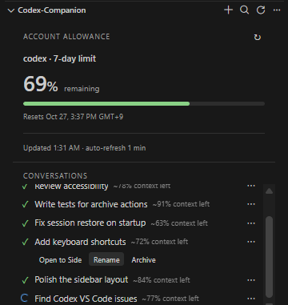

# codex-companion

Conversation tabs, renaming, archiving, and account usage for the Codex VS Code extension.
This is an independent community companion, not an official OpenAI product.
Requires the official `openai.chatgpt` extension.



*Sample conversations and illustrative context estimates.*

## Install

Install `codex-companion-0.8.0.vsix` using **Extensions → … → Install from VSIX**,
then run **Developer: Reload Window**.

If upgrading from the early `local-tools.codex-tabs` prototype, disable or
uninstall that extension to avoid duplicate views. Its custom settings and
saved tab snapshots do not migrate automatically. Conversation names and
archive state remain in Codex.

## Interface

One **codex-companion** panel appears in Explorer:

- Account allowance cards at the top show large remaining percentages,
  progress bars, and reset times. Refresh them with the panel header button.
  They refresh about once per minute while visible.
- A flat conversation list below shows status icons and muted context
  estimates such as `~62% context left`, without detailed hover popups.
  Unknown context is left blank. The list scrolls independently of the cards.

Drag the view header to another sidebar or panel using VS Code's normal
view controls. Conversation titles remain in their original language.
Companion controls, settings, and notifications use English.

### Conversation actions

- Click a conversation to focus its existing tab, or open it in a split to the side.
- Open a conversation's **?** menu and choose **Open to Side** for a split editor.
- Use **+** for an independent new tab (experimental), or search by title.
- Choose **Rename** from the conversation menu to rename it in Codex. Reopen existing Codex tabs
  to update their titles.
- Choose **Archive**, then the inline **Confirm** button. There is no modal
  dialog. **Cancel**, Escape, or clicking elsewhere dismisses the confirmation.
  Spawned child conversations may also be archived; wait for active work to
  finish first.
- The view menu includes **Restore Archived Conversation** and
  **Restore Previous Tabs**. Permanent deletion is not implemented.

### Pins and search

Choose **Pin** or **Unpin** from a conversation's menu. Pinned conversations appear
first and are remembered per workspace. Pins apply to the loaded recent list
(controlled by `codexCompanion.maxSessions`); archived conversations are hidden.

Type in **Search conversations** to filter loaded titles immediately. Enter opens
the first match; Escape clears the filter. The header search button focuses this
field. Filters stay in place during automatic updates. **Open to Side** remains
available when you intentionally want another split of an already open conversation.

### Status icons

| Icon | Meaning |
| --- | --- |
| Blue spinner | Response activity estimated from a start record and log activity within 30 seconds |
| Green check | Completion recorded |
| Yellow pause | Interruption recorded |
| Yellow history | Start recorded, but recent activity is unavailable |
| Gray question | No readable status record |

Status comes from saved logs, not a live connection to the official extension.
Approval waits and actual process liveness cannot be determined. Screen readers
receive the status label even though the row displays only the icon.

## Allowance and context are different

**Account allowance** reads `account/rateLimits/read`. It uses the actual windows
returned by the service, such as a 5-hour or 7-day limit, rather than assuming
a particular subscription. Missing limits remain unavailable. Stale results
are labeled **Last known value**, and passing a reset time does not
automatically restore the display to 100%. Exact remaining token counts are
not provided by this API.

**Session context** is an estimate of
`model_context_window - last_token_usage.total_tokens`, not accumulated billed
tokens or account allowance. New input, unrecorded output, and internal reserved
capacity are not included. After a recorded compaction it remains unknown until
a new usage record appears.

Only the last 1 MiB of each session log is read, with caching and a 10-second
refresh while the session view is visible. If relevant records are outside
that range or inaccessible, the metric is unknown. New conversations are
discovered by refreshing the list or when the session index changes.

## Compatibility and limitations

- Verified locally on Windows x64 with Codex `26.1007.21434`.
- Editor integration uses the private route
  `openai-codex://route/local/<id>` and the official custom editor. Future
  Codex versions may change these interfaces.
- New tabs use a unique query on `/extension/panel/new`. The official UI's
  own New Chat action keeps its original behavior.
- Repeated onboarding and state loss inside the official UI are not fixed.
- Tab restoration is manual and covers tabs bound to `/local/<id>`. If a new
  tab remains a placeholder, reopen its saved conversation from the list.
  The last nonempty tab snapshot is kept, even if all tabs are closed manually.
- Conversations are not filtered by workspace.
- If the session API fails, the local `session_index.jsonl` is used as a
  fallback. It may include stale or archived entries. See the output channel
  **codex-companion** for errors.
- For WSL or SSH, use the extension in the matching remote environment.
  `codexCompanion.codexHome` can select a data directory, but being able to read
  a file does not guarantee the official extension can resume that session.
  Windows management operations reject the official extension's WSL mode to
  avoid updating the wrong environment.

## Development

Use Node.js 22 or later:

```sh
npm ci
npm run check
npm test
npm run package
```

Open this folder in VS Code and press F5 to launch the Extension Development Host.
Set `CODEX_COMPANION_TEST_BINARY` to a Codex executable to enable the integration
test. It uses a synthetic conversation in an isolated temporary `CODEX_HOME`
to verify rename, archive, and restoration without real conversations,
credentials, or model requests.

Publishing instructions: [PUBLISHING.md](PUBLISHING.md).

## Data and license

No custom usage analytics are collected. Conversation management and allowance
queries go through local Codex app-server. Allowance queries cause official
Codex to contact its service; its own data handling follows its settings.
Only conversation IDs and editor positions for tab restoration are stored in
VS Code workspace state. Conversation bodies are not displayed by the companion.
The combined view uses a nonce-restricted local script for interaction and no
external resources. Conversation actions are checked against the current list
in the extension host. Refreshes preserve existing rows and open menus.

[MIT License](LICENSE)
